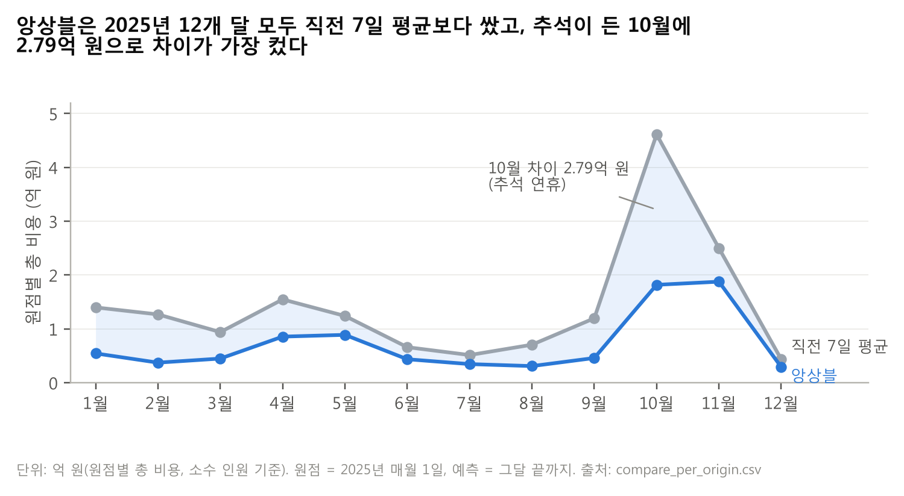

# 궁·능 관람객 예측과 개소별 인력 배치 보고서: 무료 개방일·명절을 반영한 앙상블 예측과 2026년 1월 권고

# ① 권고 요약

> **질문** 1월에 개소마다 몇 명을 두어야 하나?
> **답** 앙상블 0.8 분위수로 정한 인원을 두면, 같은 방식을 2025년에 썼을 때 직전 7일 평균보다 837,114,828원(−49.2%) 덜 들었다.

**주제는 무료 개방일과 명절 연휴, 핵심 질문은 "근무표를 짤 때 이미 알 수 있는 달력 정보만으로 직전 7일 평균의 비용을 얼마나 줄일 수 있는가"이다.** 답은 8.37억 원(−49.2%)이다(앙상블, 2025년 원점 12개 백테스트).

- **지금 방식(직전 7일 평균)은 무료 개방일에 가장 크게 틀린다.** 무료 개방일은 평가 행의 7.6%지만 직전 7일 평균 비용의 30.0%(5.11억 원)를 만든다.
- **근무표를 짤 때 이미 아는 달력 정보만으로 비용을 절반 가까이 줄였다.** 17.03억 원 → 8.66억 원(−49.2%), 12개 원점 모두에서 더 쌌다.
- **절감은 남는 인원을 늘리지 않고 모자란 인원을 막아서 나왔다.** 모자란 인원 2,159명 → 751명(−65%), 남는 인원 2,715명 → 2,768명.
- **절감의 56%는 모형, 32%는 달력 정보, 12%는 서비스 수준 보정에서 나왔다.** 달력 정보 중 공휴일이 1.50억 원으로 가장 컸다.
- **권고: 경복궁 1월 28일 13명, 근무표는 월 1회 + 공지 증원 + 수요일 하한부터.** 주 1회 확정보다 238만 원 싸고 근무자 부담은 그대로다.

**2026년 1월 인력 배치 권고** (근무표 확정 2025-12-31, 월 1회)
- 경복궁에 1월 영업일 27일 중 21일은 6~8명, 1월 1~4일과 31일은 9~10명, **1월 28일(마지막 수요일, 무료 개방일)에는 13명**을 배치한다.
- 1월 28일에는 창경궁·종묘·창덕궁에 각각 3명, 덕수궁에 7명을 배치한다.
- 왕릉 18곳은 영업일 1명, 예정 휴관일은 0명(월: 왕릉·창덕궁·창경궁·덕수궁, 화: 경복궁·종묘)을 배치한다.

**권하는 근무표 확정 방식** (근거는 ④ 4-6): ① 바로 — 월 1회 확정 + 공지된 임시 무료 개방일 증원 + 마지막 수요일 하한(근무자 부담 없이 주 1회보다 쌈) → ② 시범 — 비용의 81%가 나오는 궁·종묘 5곳만 주 1회 → ③ 시범 결과를 보고 전체 주 1회.

**전제 가정**: 모자람 1명·1일 60만 원, 남음 15만 원, 1명당 관람객 2,000명, 서비스 수준 0.8, 소수 인원 기준(정수 규칙이면 절감 6.01억 원, −29.1%). 가정을 바꿔도 앙상블이 더 쌌다(⑤ 5-5).

---

**인력 배치 권고표 (2026-01-01 ~ 01-31, 23개소 × 31일)** → 부록 표 B-1(궁·종묘 5곳, 일별 합계), B-2(왕릉 18곳)

- 칸마다 **권고 인원(정수)**과 비용 계산에 쓴 **배치 인원(소수)** = 0.8 분위수 예측 ÷ 2,000을 함께 적는다.
- 정수로 바꾼 규칙: 배치 인원(소수)을 올림하고, 영업일은 최소 1명, 예정 휴관일(92칸)은 0명(배치 인원(소수)도 0.00으로 표기). 1월 28일은 규칙 B(마지막 수요일 하한)를 반영했다. 권고 인원 합계는 992명이다.
- 출처: `권고표_2026_01_최종.csv`(713행), `권고표_2026_01_최종_피벗.csv`.

---

### 자기 점검표 (①)

| 점검 항목 | 결과 |
|---|---|
| 맡은 요구사항 | 가이드 ①: 첫 줄 주제·핵심 질문·답(효과와 비용) ✅, 숫자·단위·행동이 있는 권고 ✅, 권하는 확정 시점(2025-12-31, 월 1회 + 1단계) ✅, 기본 가정 절감액과 전제 ✅, 권고표 위치·정수 + 소수·정수 규칙 ✅ / 요구사항 8: 권고에 확정 시점 포함 ✅ |
| 분량 | 질문/답 상자 ~ 전제 가정까지가 한 쪽 분량(약 35줄). 도표 1과 권고표는 그 뒤에 둠 — Word 조립 후 실제 쪽수 확인 필요 |
| 숫자 출처 | 837,114,828원·17.03억·8.66억·−49.2%: `가정_바꾸기.csv`, `모형_비교_전체.csv` / 7.6%·30.0%·5.11억: `오차_유형별.csv`, `FVA_앙상블.csv` / 2,159·751·2,715·2,768명: `백테스트_비용.csv` / 56·32·12%·1.50억: `FVA_앙상블.csv` / 2,378,174원: `운영방안_비교.csv` / 81%: `운영방안_비교_구분별.csv` / 6.01억·29.1%: `백테스트_비용.csv` / 경복궁 일별 인원·1/28 인원·992명·92칸: `권고표_2026_01_최종.csv`, `_피벗.csv` / 2.79억: `compare_per_origin.csv` |
| 8절 반영 | 5번(3단계는 결론 한 줄씩, 숫자는 ④) ✅ / 11번(억 원) ✅ / 15번(최종권고인원 + 최종배치인원_소수, 「배치 인원(소수)」) ✅ / 16번(최종 파일만) ✅ / 사용자 결정: 휴관일 소수 0.00 ✅, 경복궁 문구(1/1·1/3 모두 10명) ✅ |
| 1절 결정과 어긋남 | 없음 (소수 기준 49.2% 기본·29.1% 참고, 규칙 B 반영, 3단계 권고, 최소 1명 유지) |
| 남은 `[팀원 결과 대기]` | 없음 |
