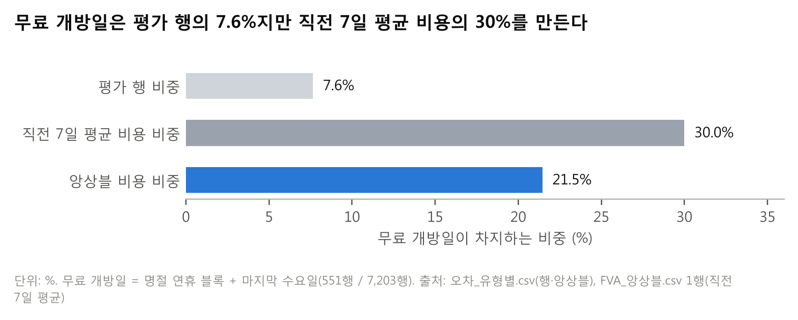

# ② 질문과 범위

> **질문** 무엇을, 언제, 어떤 기준으로 예측했나?
> **답** 23개소 × 31일을 2025-12-31에 확정하고, 개소 × 날짜 비용(원, 소수 인원)으로 평가했다.

**이 보고서는 "근무표를 짤 때 이미 알 수 있는 달력 정보만으로 직전 7일 평균의 비용을 얼마나 줄일 수 있는가"에 답한다.** 주제는 무료 개방일과 명절 연휴이고, 휴관일 처리·휴관 이동, 이웃 궁 휴관, 달력에 없는 행사를 보조 주제로 다룬다.

## 2-1. 예측 단위 · 예측 기간 · 1순위 지표

| 항목 | 정한 것 | 이유 |
|---|---|---|
| 예측 단위 | 개소별 23곳 (궁 4 · 종묘 1 · 왕릉 18) | 근무표가 개소 단위이고, 무료 개방일 배율이 개소마다 크게 다름(⑥ 도표 10) |
| 예측 기간 | 백테스트: 원점부터 그달 끝까지(28~31일) / 권고: 2026-01-01 ~ 01-31 (31일) | 근무표를 한 달 단위로 짠다고 가정. 데이터가 2025-12-31에서 끝나 권고표는 2026-01-01부터(가이드 12쪽) |
| 근무표 확정 시점 | 원점 전날 (권고표는 2025-12-31, 월 1회). 확정일까지의 데이터만 학습·전처리·예측에 씀 | 가이드 기본 가정. 다른 확정 주기는 ④ 4-6에서 비교 |
| 1순위 지표 | 총 비용(원) = 60만 원 × 모자란 인원 + 15만 원 × 남는 인원. **소수 인원 기준**으로 개소 × 날짜마다 계산해 합산 | 가이드 8쪽. 0.8 분위 pinball loss × 375원과 같음 |
| 보조 지표 | WAPE, 적중률(목표 80%, 높을수록 좋은 지표라고 볼 수 없음) | 비용 결과를 해석하는 데만 씀 |
| 휴관일 평가 규칙 | 실제 휴관(`actual_closed = 1`, 관람객 0)은 학습과 평가에서 뺌. 예정 휴관(`planned_closed = 1`, 정기 휴관 요일 + 휴관 이동)은 모든 방법에서 0명 배치 | 문을 닫은 날의 0명은 수요가 아님. 예정 휴관은 미리 아는 정보라 예측에도 씀. 평가 행은 7,203행 |

**MAPE는 쓰지 않았다.** 관람객이 하루 수십 명인 왕릉은 몇 명만 틀려도 MAPE가 크게 흔들려 인력 손실의 크기를 나타내지 못하므로, 개소 크기가 그대로 반영되는 비용(원)을 1순위로 두었다.

**직전 7일 평균은 무료 개방일에 두 번 틀린다.** 급증하는 당일에는 평균이 낮아 인원이 모자라고, 지난 뒤에는 그 급증이 평균에 섞여 평상시 날에 인원이 남는다. 가이드의 검산 예시(2025-10-14 화, 창덕궁)는 직전 7일에 추석 무료 개방일 3일이 들어 있어 12.9명을 배치했지만 필요 인원은 3.6명이었고, 남은 인원 비용이 하루 1,390,175원 생겼다. 이 보고서가 무료 개방일과 명절 연휴를 주제로 고른 이유이다.

## 2-2. 가정한 운영 상황

- 운영팀은 지금 직전 7일 평균으로 인원을 정한다 (프로젝트 가정). 비용 단가와 1명당 관람객 2,000명은 가이드 기본값이다(2-1).
- 근무표에 옮길 때는 올림하고, 영업일 최소 1명, 예정 휴관일 0명을 둔다 (팀 결정). 같은 규칙을 직전 7일 평균에도 적용한다.

## 2-3. 해석이 갈리는 요구사항에서 택한 해석

| 요구사항 | 택한 해석 |
|---|---|
| "예측 원점 5개 이상" | 2025년 매월 1일 12개. 원점마다 그달 전체를 예측 |
| "무료 개방일" 정의 | 예측에는 달력 규칙(설·추석이 든 연휴 블록 + 매월 마지막 수요일)만 씀. 유료 관람객이 0인 날을 무료 개방일로 보지 않음(⑤ 실수 5). 보정 규칙 A에서는 근무표 확정 전에 공지된 임시 무료 개방도 포함 |
| "휴관 이동" | 정기 휴관 요일이 공휴일이면 그 뒤 첫 번째 공휴일이 아닌 날로 이동 (2023~2025년 실제 휴관과 97.6% 일치) |
| "비용 계산 단위" | 가이드 8쪽에 따라 소수 인원. 정수 규칙(올림, 영업일 최소 1명) 결과는 근무표용 참고로 함께 적음 |

---

### 자기 점검표 (②)

| 점검 항목 | 결과 |
|---|---|
| 맡은 요구사항 | 요구사항 1: 단위 ✅, 기간 ✅, 확정 시점 ✅, 개소 × 날짜 계산 ✅, 휴관일 제외 규칙 ✅, MAPE를 쓰지 않은 이유 ✅ |
| 숫자 출처 | 23개소·7,203행·60만/15만/2,000명: REPORT_SPEC 1-1, 5절 / 검산 예시(12.9명, 3.6명, 1,390,175원): REPORT_SPEC 4절 요구사항 4 / 97.6%: 골격 2-3 / 도표 2: `figures/fig02_무료개방일비중.png` |
| v9 축약 | 권고 기간 문단을 2-1 표로 옮김, 2-2의 비용 단가 중복 삭제 |
| 1절 결정과 어긋남 | 없음 |
| 남은 `[팀원 결과 대기]` | 없음 |
