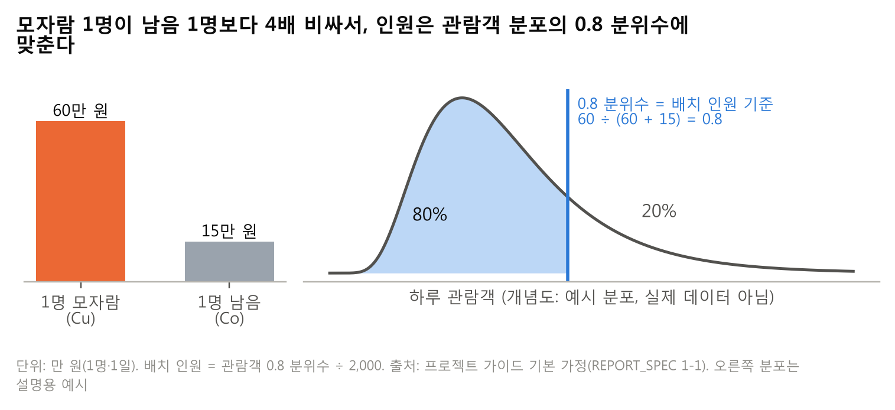

# ③ 선택과 이유

> **질문** 왜 이 모형과 이 인원 기준인가?
> **답** 모자랄 때 손실이 남을 때의 4배라서 0.8 분위수에 맞췄고, 두 모형을 50:50으로 섞은 앙상블이 가장 쌌다.

**예측 단위는 개소별, 모형은 Chronos-2 + 달력과 Prophet의 50:50 앙상블, 인원 기준은 관람객 0.8 분위수로 정했다.** 세 선택 모두 1순위 지표인 비용(원)을 기준으로 골랐고, 각각 포기한 것이 있다.

## 3-1. 무엇을 골랐고 무엇을 포기했나

| 선택 | 고른 것 | 고른 이유 | 포기한 것 |
|---|---|---|---|
| 예측 단위 | 개소별 23곳 | 근무표에 바로 옮길 수 있고, 무료 개방 효과가 개소마다 1배 미만에서 7배 넘게 달라 합치면 뭉개짐 | 관람객이 적은 왕릉은 오차 비율이 큼 (왕릉 WAPE 54.0%, ⑤) |
| 모형 | 앙상블 = Chronos-2 + 달력과 Prophet의 0.8 분위수 50:50 평균 (비율 고정, 결과를 보고 조정하지 않음) | 후보 중 총 비용이 가장 낮음 (8.66억 원). 원점 12개 중 Chronos-2 + 달력보다 9개, Prophet보다 8개 원점에서 쌈 | 계수로 설명하기 어렵고 두 모형을 함께 돌려야 함. 운영팀 설명용으로 "무료 개방일은 평소의 몇 배"를 보여 주는 배율 모형 + 월을 따로 둠 |
| 서비스 수준 | 0.8 분위수 | 모자람 60만 원, 남음 15만 원의 임계비율 60 ÷ (60 + 15) = 0.8. 이 분위수가 기대 비용을 가장 작게 만듦 | 평균적으로 5일 중 1일은 인력이 모자랄 수 있음을 받아들임 |

## 3-2. 인력 수는 관람객 분포의 0.8 분위수이다

**배치 인원 = 관람객 0.8 분위수 예측 ÷ 2,000명, 필요 인원 = 실제 관람객 ÷ 2,000명이다.** 비용은 두 값을 소수 그대로 비교해 계산한다. 근무표에 옮길 때만 올림과 영업일 최소 1명을 적용한다.

**0.8 분위수에 맞추면 비싼 쪽(모자람)을 피하는 대신 싼 쪽(남음)을 조금 더 받아들이게 된다.** 오른쪽 분포는 개념을 보여 주는 예시이고 실제 관람객 분포가 아니다.

## 3-3. 선택을 뒷받침하는 숫자

**WAPE가 가장 낮은 모형이 가장 싼 모형은 아니었다.** LightGBM(0.8)은 WAPE가 34.7%로 가장 낮지만 적중률이 69.4%로 0.8 분위수를 낮게 잡아, 총 비용이 11.01억 원으로 앙상블보다 2.35억 원 컸다. 오차의 크기만 보고 고르면 모자람 비용이 큰 이 문제에서 잘못된 모형을 고르게 되므로 비용을 1순위로 두었다. 앙상블이 모자란 인원을 줄여 비용을 낮춘 근거는 ④ 4-3, 적중률(82.0%)은 ④ 4-5에 있다.

**모형과 앙상블 비율은 2025년 백테스트 결과를 보고 골랐다.** 다른 해로는 검증하지 않았다(한계는 ⑤ 5-8).

---

### 자기 점검표 (③)

| 점검 항목 | 결과 |
|---|---|
| 맡은 요구사항 | 요구사항 3: 인력 수가 관람객 0.8 분위수임 ✅ (적중률 숫자는 ④ 4-5) / 가이드 ③: 단위·모형·서비스 수준과 포기한 것 ✅ |
| 숫자 출처 | 8.66억(865,671,727원)·11.01억(1,100,868,588원)·WAPE·적중률: `모형_비교_전체.csv` / 9개·8개 원점: `compare_per_origin.csv` / 2,159.2·750.8·2,715.1·2,767.9명: `백테스트_비용.csv` / 왕릉 WAPE 54.0%: `오차_유형별.csv` / 1배 미만~7배: `무료개방_효과_개소별.csv` / 2.35억 = 1,100,868,588 − 865,671,727 = 235,196,861원 |
| v9 축약 | 3-3의 모자란 인원·적중률 문단은 ④ 4-3·4-5와 겹쳐 참조로 바꿈, 3-4를 3-3에 합침 |
| 8절 반영 | 6번(「적중률 1위」 삭제 → 「82.0%로 목표 80%를 조금 넘음」, Chronos 80.6%가 가장 가까움) ✅ / 11번(억 원) ✅ / 12번(865,671,727원) ✅ |
| 1절 결정과 어긋남 | 없음 (최종 모형·비율 고정·0.8·개소별 그대로) |
| 남은 `[팀원 결과 대기]` | 없음 |
