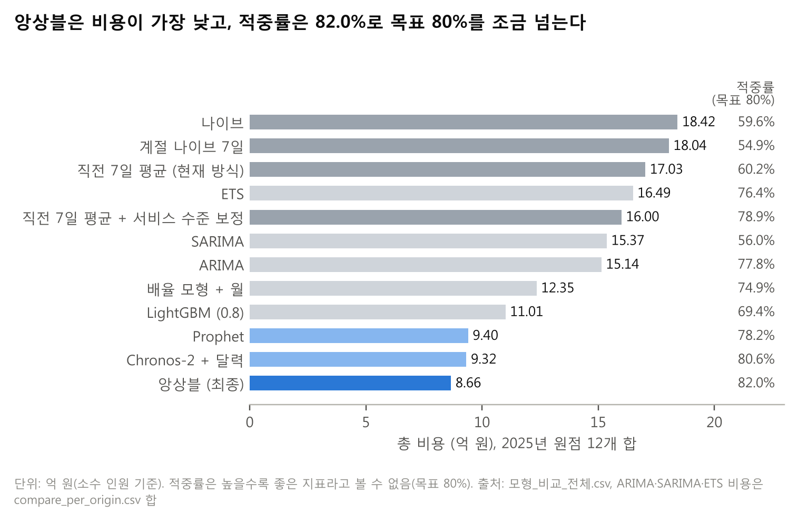
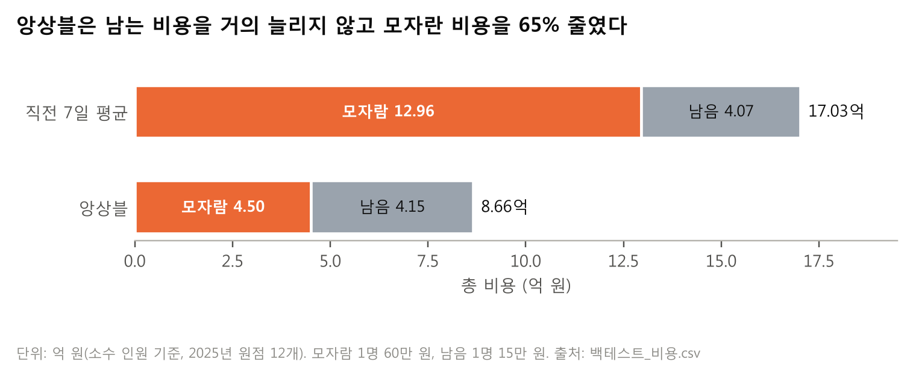
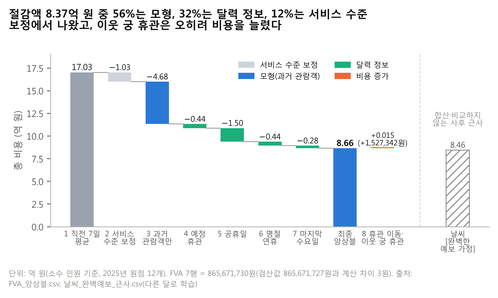
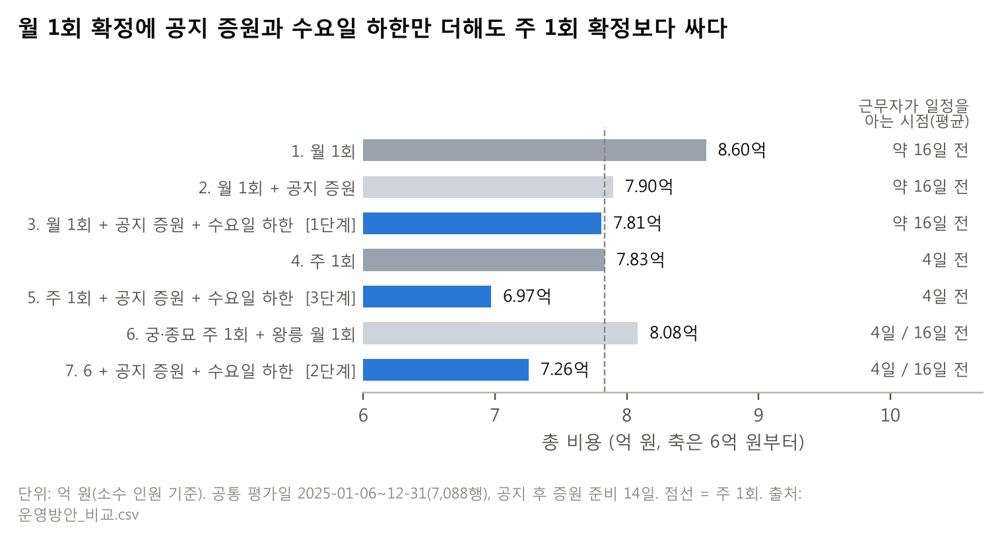

# ④ 근거와 재현 조건

> **질문** 이 숫자를 믿어도 되나?
> **답** 원점 12개 모두에서 베이스라인 3개보다 쌌고, 절감은 대부분 모자란 인원을 막아서 나왔다(모자란 비용 −65%, 남는 비용 거의 그대로).

**2025년 원점 12개 백테스트에서 앙상블의 총 비용은 8.66억 원으로, 직전 7일 평균(17.03억 원)보다 8.37억 원(−49.2%) 적었다.** 모든 비용은 소수 인원 기준이고 실제 휴관일은 평가에서 뺐다(평가 행 7,203행).

## 4-1. 백테스트 비교표 (전체 · 무료 개방일과 공휴일을 뺀 날)

| 모형 | 구분 | 총 비용 전체(원) | WAPE 전체 | 적중률 전체 | 총 비용 제외(원) | WAPE 제외 | 적중률 제외 |
|---|---|---:|---:|---:|---:|---:|---:|
| 나이브 | 베이스라인 | 1,841,654,475 | 64.3% | 59.6% | 1,289,903,475 | 65.7% | 62.8% |
| 계절 나이브 7일 | 베이스라인 | 1,803,999,675 | 57.6% | 54.9% | 1,246,640,925 | 56.6% | 57.4% |
| 직전 7일 평균 | 베이스라인 (현재 방식) | 1,702,786,555 | 54.7% | 60.2% | 1,148,352,216 | 54.3% | 63.5% |
| 직전 7일 평균 + 서비스 수준 보정 | FVA 2행 | 1,599,987,968 | 76.8% | 78.9% | 1,137,445,372 | 82.2% | 81.9% |
| **앙상블 (Chronos-2 + 달력, Prophet 50:50)** | **최종** | **865,671,727** | **39.5%** | **82.0%** | **648,968,181** | **37.1%** | **83.1%** |
| Chronos-2 + 달력 | 후보 | 931,895,939 | 43.2% | 80.6% | 668,916,510 | 40.8% | 82.2% |
| Prophet | 후보 | 939,506,502 | 40.0% | 78.2% | 696,730,928 | 35.9% | 78.9% |
| LightGBM (0.8) | 후보 | 1,100,868,588 | 34.7% | 69.4% | 809,893,586 | 31.6% | 69.8% |
| 배율 모형 + 월 | 설명용 | 1,234,702,414 | 50.5% | 74.9% | 937,787,019 | 47.0% | 76.0% |

「제외」 = 공휴일 · 명절 연휴 · 마지막 수요일을 뺀 날. 적중률의 목표는 80%이며 높을수록 좋은 지표라고 볼 수 없다. 통계 모형(ARIMA·SARIMA·ETS)을 포함한 18개 모형 전체는 부록 표 A-1.

> **주석 (금액 표기)** 본문은 앙상블 총 비용을 865,671,727원, 절감을 837,114,828원으로 쓴다. 파일에 따라 항목별·원점별 반올림 때문에 865,671,728원·865,671,730원, 837,114,824~837,114,827원으로 나오며 모두 같은 결과이다. 앙상블의 무료 개방일 비용은 저장된 예측(`pred_ensemble.csv`)으로 다시 계산한 185,730,428원을 쓴다(FVA 표를 만든 계산에서는 185,730,436원).

**특별한 날을 빼면 앙상블 비용이 25.0% 줄어든다.** 비용의 4분의 1이 평가 행의 10.5%(공휴일 2.9% + 무료 개방일 7.6%)에서 나온다는 뜻이다. 후보 모형 모두 직전 7일 평균보다 크게 쌌으므로(Chronos-2 + 달력 −45.3%, Prophet −44.8%), 절감은 특정 모형 하나에만 기대지 않는다.

## 4-2. 원점별 학습 구간과 비용

학습은 언제나 2023-01-01부터 원점 전날까지의 데이터만 쓴다(확장 창). 예정 휴관은 미리 알 수 있으므로 예측 구간에도 쓰고, 실제 휴관은 평가에서 빼는 데만 쓴다.

| 원점 | 학습 구간 | 학습 일수 | 예측 구간 | 나이브(원) | 계절 나이브 7일(원) | 직전 7일 평균(원) | 앙상블(원) | 절감(원) |
|---|---|---:|---|---:|---:|---:|---:|---:|
| 2025-01-01 | 2023-01-01 ~ 2024-12-31 | 731 | 01-01 ~ 01-31 | 143,462,775 | 139,715,100 | 139,948,512 | 54,480,731 | 85,467,781 |
| 2025-02-01 | 2023-01-01 ~ 2025-01-31 | 762 | 02-01 ~ 02-28 | 150,486,825 | 117,265,500 | 126,962,125 | 37,382,454 | 89,579,671 |
| 2025-03-01 | 2023-01-01 ~ 2025-02-28 | 790 | 03-01 ~ 03-31 | 109,883,400 | 105,719,775 | 94,111,030 | 44,950,883 | 49,160,147 |
| 2025-04-01 | 2023-01-01 ~ 2025-03-31 | 821 | 04-01 ~ 04-30 | 189,828,075 | 172,837,725 | 154,820,525 | 85,717,717 | 69,102,808 |
| 2025-05-01 | 2023-01-01 ~ 2025-04-30 | 851 | 05-01 ~ 05-31 | 150,978,600 | 113,620,125 | 124,104,957 | 88,977,415 | 35,127,542 |
| 2025-06-01 | 2023-01-01 ~ 2025-05-31 | 882 | 06-01 ~ 06-30 | 70,875,900 | 67,768,050 | 66,098,712 | 43,677,658 | 22,421,054 |
| 2025-07-01 | 2023-01-01 ~ 2025-06-30 | 912 | 07-01 ~ 07-31 | 46,884,450 | 50,253,000 | 51,484,500 | 34,685,398 | 16,799,102 |
| 2025-08-01 | 2023-01-01 ~ 2025-07-31 | 943 | 08-01 ~ 08-31 | 75,411,450 | 90,584,475 | 70,678,655 | 30,992,325 | 39,686,330 |
| 2025-09-01 | 2023-01-01 ~ 2025-08-31 | 974 | 09-01 ~ 09-30 | 156,913,200 | 146,312,925 | 119,741,388 | 45,978,805 | 73,762,583 |
| 2025-10-01 | 2023-01-01 ~ 2025-09-30 | 1,004 | 10-01 ~ 10-31 | 457,510,650 | 469,819,350 | 461,307,438 | 181,906,200 | 279,401,238 |
| 2025-11-01 | 2023-01-01 ~ 2025-10-31 | 1,035 | 11-01 ~ 11-30 | 235,529,400 | 269,286,600 | 249,965,962 | 187,750,926 | 62,215,036 |
| 2025-12-01 | 2023-01-01 ~ 2025-11-30 | 1,065 | 12-01 ~ 12-31 | 53,889,750 | 60,817,050 | 43,562,750 | 29,171,218 | 14,391,532 |
| **합계** | | | | **1,841,654,475** | **1,803,999,675** | **1,702,786,555** | **865,671,727** | **837,114,828** |

절감 = 직전 7일 평균 − 앙상블. 원점별 값의 단순 합은 반올림 때문에 합계 행과 1~4원 다르다(4-1 주석). 원점별 WAPE는 부록 표 A-2.

**앙상블은 12개 원점 모두에서 베이스라인 3개보다 쌌다.** 차이가 가장 큰 달은 추석이 든 10월(2.79억 원, ① 도표 1)이다. 3월은 앙상블의 WAPE(47.3%)가 직전 7일 평균(31.9%)보다 나빴지만 비용은 더 적었다. 오차의 크기보다 모자람과 남음의 방향이 비용을 좌우한다는 예이다.

**10월·11월 두 원점이 앙상블 비용의 42.7%를 차지한다.** 추석 연휴와 코리아 그랜드 페스티벌 무료입장이 든 달로, 남은 오차가 특별한 날에 몰려 있다(⑤).

## 4-3. 비용과 절감액

**기본 가정(소수 인원)에서 절감액은 837,114,828원(8.37억 원, −49.2%)이다.** 근무표에 옮기는 권고 규칙(올림, 영업일 최소 1명)을 두 방식에 똑같이 적용하면 직전 7일 평균 20.69억 원 → 앙상블 14.67억 원으로 6.01억 원(−29.1%) 줄어든다. 올림 때문에 두 방식 모두 남는 인원이 크게 늘어 절감률이 낮아진다(참고 값).

| 기준 | 모형 | 모자란 인원 | 모자란 비용(원) | 남는 인원 | 남는 비용(원) | 총 비용(원) | 절감(원) |
|---|---|---:|---:|---:|---:|---:|---:|
| 소수 (기본) | 직전 7일 평균 | 2,159.2명 | 1,295,515,713 | 2,715.1명 | 407,270,842 | 1,702,786,555 | — |
| 소수 (기본) | 앙상블 | 750.8명 | 450,487,624 | 2,767.9명 | 415,184,103 | 865,671,727 | 837,114,828 (49.2%) |
| 권고 규칙 (참고) | 직전 7일 평균 | 1,620.0명 | 972,007,200 | 7,310.6명 | 1,096,588,200 | 2,068,595,400 | — |
| 권고 규칙 (참고) | 앙상블 | 560.8명 | 336,507,000 | 7,539.4명 | 1,130,913,150 | 1,467,420,150 | 601,175,250 (29.1%) |

**절감은 대부분 "모자람을 막은 것"에서 나왔다.** 모자란 비용은 12.96억 원에서 4.50억 원으로 줄었고, 남는 비용은 4.07억 원에서 4.15억 원으로 791만 원 늘었을 뿐이다.

**절감액을 가이드의 두 갈래로 나누면 보정분 1.03억 원(12.3%) + 모형분 7.34억 원(87.7%)이다.** 모형분은 과거 관람객만 쓴 모형 4.68억 원(55.9%)과 달력 정보(예정 휴관·공휴일·명절·마지막 수요일) 2.67억 원(31.9%)으로 나뉜다(4-4 FVA 2행, 3행, 4~7행).

## 4-4. FVA 표 (최종 모형 기준, 소수 인원)

각 행은 앞 행에 정보를 하나씩 더한 결과이다. 1·2행은 운영팀 기준선이고, 3행부터는 최종 모형(앙상블)이다. 비용이 늘어난 8행도 남겼다.

| 행 | 더한 정보 | 1순위 지표: 총 비용(원) | 앞 행 대비 감소(원) | 행 1 대비 감소(원) | 무료 개방일 비용(원) | WAPE | 적중률 |
|---|---|---:|---:|---:|---:|---:|---:|
| 1 | 직전 7일 평균 (현재 방식) | 1,702,786,555 | — | 0 | 510,909,652 | 54.7% | 60.2% |
| 2 | + 서비스 수준 보정 (0.8) | 1,599,987,968 | 102,798,587 | 102,798,587 | 436,199,398 | 76.8% | 78.9% |
| 3 | 과거 관람객만 (Chronos-2 단변량 + Prophet) | 1,132,292,907 | 467,695,061 | 570,493,648 | 413,059,282 | 43.3% | 80.9% |
| 4 | + 예정 휴관 | 1,087,883,627 | 44,409,280 | 614,902,928 | 356,787,436 | 43.4% | 81.2% |
| 5 | + 공휴일 | 937,650,314 | 150,233,313 | 765,136,241 | 251,790,690 | 40.5% | 81.9% |
| 6 | + 명절 연휴 | 894,089,360 | 43,560,954 | 808,697,195 | 216,928,397 | 40.8% | 82.2% |
| 7 | + 마지막 수요일 = **최종 앙상블** | 865,671,730 | 28,417,630 | 837,114,825 | 185,730,428 | 39.5% | 82.0% |
| 8 | + 휴관 이동 · 이웃 궁 휴관 (추가 실험, 최종에서 뺌) | 867,199,072 | **−1,527,342 (증가)** | 835,587,483 | 185,216,103 | 39.9% | 82.4% |

2행의 보정은 원점 전 기록에서 "실제 ÷ 직전 7일 평균"의 0.8 분위수를 곱한 것이다. 예정 휴관일 0명 배치는 1~8행 모두에 적용되며, 4행은 예정 휴관을 Chronos-2의 입력 공변량으로 더한 효과이다(Prophet 비용은 3·4행이 같음).

**서비스 수준 보정은 비용을 1.03억 원 줄이지만 WAPE는 54.7% → 76.8%로 나빠진다.** 일부러 넉넉히 잡기 때문이며, 비용을 1순위로 둔 이유이다.

**달력 정보 중에서는 공휴일이 1.50억 원으로 가장 컸고, 무료 개방일 비용은 1행 5.11억 원에서 7행 1.86억 원으로 64% 줄었다.**

**휴관 이동과 이웃 궁 휴관은 비용을 153만 원 늘려 최종 모형에서 뺐다(8행).** 휴관 이동은 이미 예정 휴관 열에 반영되어 있었다.

**날씨는 권고에 쓰지 않았고, [완벽한 예보 가정]으로 효과의 상한만 근사했다.** 예측하는 날의 실측 날씨는 근무표 확정 시점에 알 수 없고(가이드 7쪽), 날씨 파일에 2026년 1월 값도 없다. 근사는 모형을 다시 학습하지 않고, 앙상블 오차(log 실제 ÷ 예측)를 당일 강수량·최고기온으로 설명하는 회귀를 궁·종묘·왕릉별로 만들어 예측을 보정했다.

| 방식 (2025년 원점 12개, 소수 기준) | 총 비용(원) | 앙상블 대비 감소(원) | WAPE | 적중률 |
|---|---:|---:|---:|---:|
| 앙상블 (최종, 날씨 없음) | 865,671,728 | — | 39.5% | 82.0% |
| + 날씨 **[완벽한 예보 가정]**, 다른 달로 학습 | 846,029,975 | 19,641,753 (2.3%) | 39.2% | 82.6% |
| + 날씨 **[완벽한 예보 가정]**, 앞선 달로만 학습 | 864,479,977 | 1,191,751 (0.1%) | 39.5% | 81.2% |

이 표는 사후 보정 근사이므로 다른 결과와 합산하지 않는다(감소 열은 파일 값 865,671,728원 기준). **날씨를 완벽하게 알아도 줄일 수 있는 비용은 약 0.20억 원(2.3%) 이하로, 달력 정보(2.67억 원)의 10분의 1도 안 된다.**

## 4-5. 적중률과 포함률

- **적중률**: 필요 인원(실제 ÷ 2,000) ≤ 배치 인원(0.8 분위수 예측 ÷ 2,000)인 날의 비율(실제 휴관일 제외). 목표는 서비스 수준과 같은 80%이며 높을수록 좋은 지표라고 볼 수 없다.
- **앙상블 적중률은 82.0%**(제외 날 83.1%)로 목표 80%를 조금 넘는다(약간 넉넉한 쪽). 80%에 가장 가까운 모형은 Chronos-2 + 달력(80.6%)이고, Prophet은 78.2%, 직전 7일 평균은 60.2%이다.
- **포함률**: 구간 예측을 쓰지 않고 분위수 하나로 인원을 정해 해당 없음.

## 4-6. 근무표 확정 시점별 비용 (요구사항 8)

**결론: 근무표는 지금처럼 월 1회 확정하되, 공지된 임시 무료 개방일 증원과 마지막 수요일 하한을 더하는 방식(방안 3, 1단계)을 먼저 권한다.**

- **비용:** 방안 3은 월 1회 확정보다 79,269,212원(0.79억 원) 적고, 주 1회 확정(방안 4)보다도 238만 원(2,378,174원) 싸다.
- **근무자 부담:** 근무자가 일정을 아는 시점은 지금과 같은 평균 약 16일 전이다. 주 1회로 바꾸면 평균 4일 전으로 짧아진다.
- **다음 단계:** 비용의 81%가 나오는 궁·종묘 5곳만 주 1회로 시범 운영하면(2단계, 방안 7) 월 1회보다 1.34억 원, 전체를 주 1회 + 규칙으로 바꾸면(3단계, 방안 5) 1.63억 원 줄어든다. 주 1회 절감은 인력을 주 단위로 조정할 수 있을 때(단기 인력, 개소 간 이동)만 실현된다.
- **주의:** 방안 3의 절감 중 공지 증원 몫(0.70억 원)은 2025년 코리아 그랜드 페스티벌 하나에서 나온 참고 값이다. 해마다 기대할 수 있는 값은 수요일 하한 몫(약 882만 원)에 가깝다.

모든 방식이 예측한 공통 평가일 2025-01-06 ~ 2025-12-31(7,088행)에서 같은 앙상블로 비교했다(4-1과 평가일이 달라 직접 비교하지 않음).

**운영 방안 7개 — 앙상블, 공지 후 증원 준비 기간 14일**

| 방안 | 근무자가 일정을 아는 시점 | 총 비용(원) | 월 1회 대비 감소(원) | 권고 규칙 비용(원, 참고) | 적중률 |
|---|---|---:|---:|---:|---:|
| 1. 월 1회 확정 | 평균 약 16일 전 | 860,058,276 | — | 1,450,986,450 | 81.9% |
| 2. 월 1회 + 공지 행사 증원 | 평균 약 16일 전 | 789,607,178 | 70,451,098 | 1,401,914,325 | 83.4% |
| **3. 월 1회 + 공지 증원 + 수요일 하한 (1단계)** | 평균 약 16일 전 | **780,789,064** | **79,269,212** | 1,398,513,825 | 83.8% |
| 4. 주 1회 확정 | 평균 4일 전 | 783,167,238 | 76,891,038 | 1,396,197,075 | 82.6% |
| **5. 주 1회 + 공지 증원 + 수요일 하한 (3단계)** | 평균 4일 전 | **697,035,657** | **163,022,619** | 1,333,440,825 | 84.3% |
| 6. 궁·종묘 주 1회 + 왕릉 월 1회 | 궁·종묘 4일 / 왕릉 16일 | 808,285,518 | 51,772,758 | 1,404,505,950 | 82.1% |
| **7. 6 + 공지 증원 + 수요일 하한 (2단계)** | 궁·종묘 4일 / 왕릉 16일 | **725,575,571** | **134,482,705** | 1,344,963,450 | 83.8% |

- **공지 행사 증원**: 근무표를 확정한 뒤라도 임시 무료 개방 공지가 행사 14일 전까지 나오면, 그 행사일만 개소별 무료 개방 배율만큼 인원을 추가한다(230행). 2025년에는 코리아 그랜드 페스티벌(공지 10/16, 행사 10/29~11/9)이 해당한다.
- **수요일 하한**: 마지막 수요일 예측이 같은 요일 평상시 예측 × 개소별 배율보다 낮으면 그 값으로 올린다(⑤ 규칙 B).

**확정 주기만 바꾸면 2주 1회는 월 1회보다 0.27억 원, 주 1회는 0.77억 원(−8.9%) 줄지만 효과가 고르지 않다.** 주 1회는 12개월 중 11개월에서 월 1회보다 쌌고(8월만 16만 원 비쌈), 2주 1회는 11월에 0.13억 원 비쌌다. 직전 7일 평균(−2.30억 원)과 서비스 수준 보정(−2.88억 원)에서도 주 1회가 가장 싸, 앙상블만의 결과가 아니다.

**왕릉의 주 1회 효과는 작다.** 방안 1 기준 비용의 81%가 궁(6.25억 원)·종묘(0.70억 원)에서 나오고, 왕릉을 주 1회로 바꾸면 0.25억 원만 줄어 18곳의 근무표를 매주 다시 짜는 부담에 비해 작다. 그래서 2단계에서는 궁·종묘만 주 1회로 바꾼다.

## 4-7. 재현 조건

| 항목 | 값 |
|---|---|
| 데이터 | `train_2023_2025_core_v2.csv`: 2023-01-01 ~ 2025-12-31, 23개소 × 1,096일 = 25,208행 · 20열 |
| 분할 방식 | 시간 순서 백테스트. 2025년 매월 1일 원점 12개, 학습 = 2023-01-01 ~ 원점 전날(확장 창, 4-2 표), 예측 = 원점부터 그달 끝. 주 1회 비교는 2025-01-06부터 매주 월요일 52개, 2주 1회는 26개 |
| 평가 규칙 | 실제 휴관(`actual_closed = 1`) 제외, 예정 휴관(`planned_closed = 1`) 0명 배치, 비용은 소수 인원, 평가 행 7,203행 |
| 최종 모형 | 앙상블 = Chronos-2 + 달력과 Prophet의 0.8 분위수 50:50 평균 (비율 고정) |
| Chronos-2 | `amazon/chronos-2` (chronos-forecasting 2.3.2, CPU, 제로샷: 추가 학습 없이 0.8 분위수를 바로 출력, 무작위성 없음). 입력 길이 = 2023-01-01부터 원점 전날까지 전체, 휴관일 target은 결측. 공변량: is_holiday, is_myeongjeol, is_last_wednesday, planned_closed |
| Prophet | Prophet 1.5.0, 기본 설정 + 잔차 0.8 분위수 더하기, 예측 상한 = 개소 과거 최대의 2배. 외생변수: is_holiday, is_myeongjeol, is_last_wednesday |
| 시드 | LightGBM 42 (Chronos-2·Prophet은 무작위성 없음) |
| 라이브러리 버전 | pandas 3.0.6, numpy 2.5.4, statsmodels 0.15.0, lightgbm 4.7.0, torch 2.14.1, holidays 0.103 (2026년 공휴일만 사용) |
| 실행 순서 | `run_classic.py` → `run_chronos.py` → `run_stat.py` → `ensemble.py` → `backtest_cost.py` → `run_fva.py` → `assumptions.py` → `error_analysis.py` → `run_weekly.py --biweekly` → `compare_plans.py --lead 14` → `forecast_2026.py` (옵션은 저장소 README) |
| 실행 환경 | Chronos-2·Prophet은 Colab에서 실행(Chronos-2는 CPU 설정, 주 1회 비교는 약 1,200번 학습). 나머지 표는 저장된 예측(`pred_ensemble.csv`)으로 다시 만들 수 있음 |
| 누수 확인 | 원점 전날까지만 쓰는지 확인하는 누수 테스트 3개 통과 (`tests/test_leakage.py`). `actual_closed`는 평가 마스크로만 사용 |

**검산값 7개는 모두 맞았다.** 관람객 표 행 수 62,028, 개소 수 23(궁 4 · 종묘 1 · 왕릉 18), `total` 합계 119,991,391, 외국인 4열 합계 22,960,148, `total`이 0인 행 8,832, 날씨 표 92,414행, 달력 4,018행이 가이드의 검산값과 일치했다. 가이드의 비용 검산 예시(2025-10-14 창덕궁, 직전 7일 평균 남는 비용 1,390,175원)도 팀 코드로 재현했다.

---

### 자기 점검표 (④)

| 점검 항목 | 결과 |
|---|---|
| 맡은 요구사항 | 요구사항 2: 원점 12개와 학습 구간 날짜 ✅, 베이스라인 3개 + 최종 모형의 원점별 비용 ✅, 전체/제외 비교표 ✅ / 요구사항 3: 적중률 숫자 ✅, 포함률 해당 없음 ✅ / 요구사항 4: 모자란·남는 비용, 직전 7일 평균 비용, 절감액(원), 보정분 + 모형분 분해 ✅ (가정 바꾸기는 ⑤) / 요구사항 5: 데이터 구간·분할·시드·설정·검산값 7개 문장 ✅ / 요구사항 6: FVA 표 1개, 8행(증가) 유지, 날씨 [완벽한 예보 가정] 별도 ✅ / 요구사항 8: 확정 시점 3개 + 운영 방안 7개, 같은 평가 날짜, 근무자 부담 ✅ |
| 숫자 출처 | 4-1: `모형_비교_전체.csv`, ARIMA·SARIMA·ETS 비용 `compare_per_origin.csv` 합 / 4-2: `compare_per_origin.csv`, 학습 일수는 골격 4-2 / 4-3: `백테스트_비용.csv`, 분해는 `FVA_앙상블.csv` / 4-4: `FVA_앙상블.csv`(7행 무료 개방일 비용만 `오차_유형별.csv`), `날씨_완벽예보_근사.csv` / 4-6: `확정시점_비교.csv`, `확정시점_비교_월별.csv`, `운영방안_비교.csv`, `운영방안_비교_구분별.csv` / 4-7: REPORT_SPEC 1-1 「실행 환경·버전」, 골격 4-8, 5절 검산값 / 도표 4~7: `figures/fig04_v2·fig05·fig06·fig07` |
| v9 축약 | 4-1 표에서 통계 모형 3행을 부록 A-1로, 절감액 분해 표를 문장으로, 4-6 (나) 확정 주기 표를 문장으로 바꿈. 주석·FVA 설명·날씨 설명을 줄임 |
| 8절 반영 | 2번(원점별 표에 나이브·계절 나이브 열) ✅ / 3번(가정 바꾸기 표를 ⑤로 이동) ✅ / 8번(FVA 4행 뜻) ✅ / 9번(체크포인트·입력 길이·버전 추가, 「SARIMA는 로컬과 WAPE가 다름」 삭제) ✅ / 11번(억 원) ✅ / 12번(865,671,727원 + 주석 한 번) ✅ / 13번 → ⑤ 5-3에 둠 / 14번(`compare_per_origin.csv` 인용) ✅ |
| 1절 결정과 어긋남 | 없음. 적중률은 「목표 80%를 조금 넘음」으로만 서술 |
| 남은 `[팀원 결과 대기]` | 없음 |
