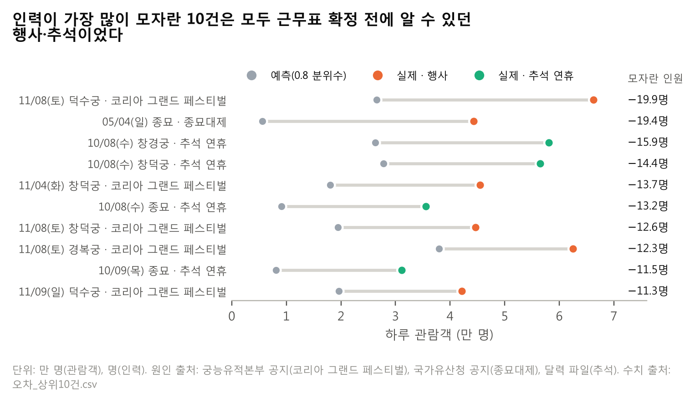
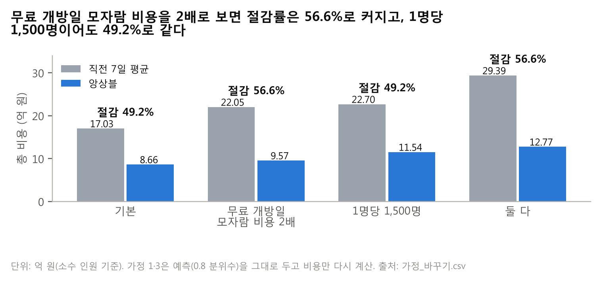

# ⑤ 오차 분석과 한계

> **질문** 어디서 여전히 틀리나?
> **답** 가장 많이 모자란 10건은 모두 근무표 확정 전에 알 수 있던 행사·추석이었고, 공지 증원과 수요일 하한으로 78,274,092원을 더 줄였다.

**앙상블의 남은 오차는 무료 개방일과 궁에 몰려 있고, 공휴일은 비용은 작지만 모자라는 쪽으로 치우쳐 있다.** 가장 많이 모자란 10건은 행사 6건과 추석 연휴 4건으로 모두 근무표 확정 전에 알 수 있던 날이었다. 이 중 하나(임시 무료 개방)와 매달 반복되는 마지막 수요일을 보정 규칙으로 다루면 비용이 0.78억 원(9.0%) 더 줄어든다.

## 5-1. 유형별 지표와 적중률

앙상블, 2025년 원점 12개, 실제 휴관 제외, 소수 인원 기준.

| 구분 | 유형 | 행 수 (비중) | 총 비용(원) | 비용 비중 | 모자란 비용(원) | WAPE | 적중률 |
|---|---|---|---:|---:|---:|---:|---:|
| 전체 | 전체 | 7,203 (100%) | 865,671,727 | 100% | 450,487,624 | 39.5% | 82.0% |
| 날짜 | 평일 | 4,171 (57.9%) | 334,907,612 | 38.7% | 160,086,008 | 35.7% | 83.9% |
| 날짜 | 주말 | 2,274 (31.6%) | 314,060,569 | 36.3% | 174,565,433 | 38.8% | 81.7% |
| 날짜 | 공휴일 | 207 (2.9%) | 30,973,118 | 3.6% | 24,050,311 | 29.3% | **55.6%** |
| 날짜 | 무료 개방일 | 551 (7.6%) | 185,730,428 | **21.5%** | 91,785,872 | 53.4% | 79.7% |
| 개소 | 궁 | 1,261 (17.5%) | 628,812,956 | **72.6%** | 322,400,691 | 36.2% | 79.3% |
| 개소 | 종묘 | 314 (4.4%) | 70,472,240 | 8.1% | 56,399,624 | 49.3% | 78.7% |
| 개소 | 왕릉 | 5,628 (78.1%) | 166,386,532 | 19.2% | 71,687,310 | 54.0% | 82.8% |

날짜 유형은 겹치지 않게 나눴다(평일·주말 = 공휴일과 무료 개방일이 아닌 날, 합 6,445행 · 648,968,181원). 적중률의 목표는 80%이며 높을수록 좋은 지표라고 볼 수 없다.

**공휴일은 적중률이 55.6%로 가장 낮아, 10일 중 4일 넘게 인력이 모자랐다.** 비용 비중은 3.6%로 작지만 모자람 쪽으로 치우친 오차이다.

**무료 개방일은 행의 7.6%인데 비용의 21.5%를 차지한다.** 앙상블이 직전 7일 평균(30.0%)보다 비중을 줄였지만, 여전히 행 수에 비해 비용이 가장 많이 몰리는 날짜 유형이다(약 2.8배). 주말도 행의 31.6%에 비용의 36.3%로 평일보다 모자란 비용이 크다.

**궁 4곳이 비용의 72.6%를 만든다.** 왕릉은 WAPE가 54.0%로 가장 높지만 관람객이 적어 비용 비중은 19.2%이다. 비용을 줄이려면 궁부터 다뤄야 한다는 뜻이며, ④ 4-6에서 궁·종묘만 주 1회 시범을 권하는 근거이다.

## 5-2. 인력이 가장 많이 모자란 10건

| 순위 | 날짜 | 개소 | 실제 관람객 | 예측 관람객 (0.8 분위수) | 모자란 인원 | 원인 (한 문장) | 출처 | 확정 전에 알 수 있었나 |
|---:|---|---|---:|---:|---:|---|---|---|
| 1 | 2025-11-08 (토) | 덕수궁 | 66,257 | 26,551 | 19.85 | 코리아 그랜드 페스티벌 기간 무료입장으로 관람객이 늘었다 | 궁능유적본부 공지[^1] | 예 (공지 10/16, 확정 10/31) |
| 2 | 2025-05-04 (일) | 종묘 | 44,337 | 5,607 | 19.36 | 5월 첫 일요일에 열리는 종묘대제 날이었다 | 국가유산청 공지[^2] | 예 (매년 5월 첫 일요일) |
| 3 | 2025-10-08 (수) | 창경궁 | 58,122 | 26,264 | 15.93 | 추석 연휴 무료 개방일이었다 | 달력 파일[^3] | 예 (달력) |
| 4 | 2025-10-08 (수) | 창덕궁 | 56,508 | 27,783 | 14.36 | 추석 연휴 무료 개방일이었다 | 달력 파일[^3] | 예 (달력) |
| 5 | 2025-11-04 (화) | 창덕궁 | 45,452 | 18,032 | 13.71 | 코리아 그랜드 페스티벌 기간 무료입장으로 관람객이 늘었다 | 궁능유적본부 공지[^1] | 예 (공지 10/16, 확정 10/31) |
| 6 | 2025-10-08 (수) | 종묘 | 35,524 | 9,146 | 13.19 | 추석 연휴 무료 개방일이었다 | 달력 파일[^3] | 예 (달력) |
| 7 | 2025-11-08 (토) | 창덕궁 | 44,669 | 19,482 | 12.59 | 코리아 그랜드 페스티벌 기간 무료입장으로 관람객이 늘었다 | 궁능유적본부 공지[^1] | 예 (공지 10/16, 확정 10/31) |
| 8 | 2025-11-08 (토) | 경복궁 | 62,517 | 37,947 | 12.29 | 코리아 그랜드 페스티벌 기간 무료입장으로 관람객이 늘었다 | 궁능유적본부 공지[^1] | 예 (공지 10/16, 확정 10/31) |
| 9 | 2025-10-09 (목) | 종묘 | 31,131 | 8,074 | 11.53 | 추석 연휴 무료 개방일이었고 한글날과 겹쳤다 | 달력 파일[^3] | 예 (달력) |
| 10 | 2025-11-09 (일) | 덕수궁 | 42,187 | 19,651 | 11.27 | 코리아 그랜드 페스티벌 기간 무료입장으로 관람객이 늘었다 | 궁능유적본부 공지[^1] | 예 (공지 10/16, 확정 10/31) |

모자란 인원 = (실제 − 예측) ÷ 2,000.

[^1]: 궁능유적본부 공지사항 「코리아 그랜드 페스티벌 기간(10.29.~11.9.) 무료입장 안내」 (2025-10-16 게시). https://royal.khs.go.kr/ROYAL/contents/R403000000.do?schFld=0&schStr=%EB%AC%B8%ED%99%94%ED%96%A5%EC%9C%A0&schM=view&page=1&ordBy=DESC&viewCount=10&id=20251016153922339892&schBdcode=all&schGroupCode=all
[^2]: 국가유산청 공지 (2025년 종묘대제). https://www.cha.go.kr/multiBbz/selectMultiBbzView.do?id=21002&no=27662&bbzId=newpublic&pageIndex=13&pageUnit=10&strWhere=t&searchWrd=&sdate=&edate=&mn=NS_01_01 (원래 링크에서 만료되는 세션값을 뺀 주소)
[^3]: 달력 파일 `calendar_kr_2015_2025.csv`의 명절 연휴·공휴일 열.

**행사 6건은 모형 입력에 없던 정보였다.** 코리아 그랜드 페스티벌 무료입장 5건은 달력 규칙(명절 연휴 + 마지막 수요일)에 없는 임시 무료 개방이고, 종묘대제 1건은 데이터의 달력 열에 없는 정기 행사이다. 두 행사 모두 근무표 확정 전에 공지되었거나 매년 날짜가 정해져 있어, 입력으로 넣을 수 있었던 정보이다.

**추석 4건은 입력에 있었지만 크기를 작게 잡았다.** 모형은 명절 연휴를 입력으로 알고 있었지만 증가 폭을 작게 예측했다. 2025년 추석 연휴(10/3~10/9, 7일)가 학습 기간의 어느 명절 연휴(최장 6일)보다 길었던 것이 한 원인일 수 있다(원인은 확인하지 않음).

## 5-3. 보정 규칙과 적용 전후 비용

**두 보정 규칙을 같은 원점에서 다시 계산하면 비용이 78,274,092원(0.78억 원, 9.0%) 줄어든다.** 두 규칙 모두 근무표 확정 시점에 알 수 있는 정보만 쓰고, 비용을 늘리지 않았다.

| 규칙 | 총 비용(원) | 보정 전 대비 감소(원) | 바뀐 행 | 적중률 |
|---|---:|---:|---:|---:|
| 보정 전 (앙상블) | 865,671,728 | — | — | 82.0% |
| 규칙 A: 공지된 임시 무료 개방일 × 개소별 배율 | 796,215,750 | 69,455,978 | 184 | 83.2% |
| 규칙 B: 마지막 수요일 하한 | 856,853,614 | 8,818,114 | 183 | 82.5% |
| **A + B** | **787,397,636** | **78,274,092 (9.0%)** | 367 | 83.6% |

보정 전 비용과 감소 열은 파일 값 865,671,728원 기준이다(④ 4-1 주석).

- **규칙 A**: 임시 무료 개방일에 예측을 개소별 무료 개방 배율로 곱한다. 배율은 원점 전날까지의 기록으로만 계산한다. 공지일이 근무표 확정일(원점 전날)보다 빨라야 적용하므로, 11월 원점(확정 10/31)의 11/1~11/9에만 적용했다. 10월 원점(확정 9/30)의 10/29~10/31은 공지(10/16)가 확정 뒤라 적용하지 않았다.
- **규칙 B**: 마지막 수요일 예측이 같은 요일 평상시 예측 × 개소별 배율보다 낮으면 그 값으로 올린다.
- **2026년 1월 28일에 규칙 B를 적용했다**: 경복궁 11명 → 13명, 창경궁 2명 → 3명, 종묘 2명 → 3명. 덕수궁(7명), 창덕궁(3명), 왕릉(1명)은 그대로이다.
- ④ 4-6 방안 3의 절감(79,269,212원)과 다른 것은 평가 기간(4-6은 2025-01-06부터)과 공지 반영 방식(4-6은 확정 뒤라도 행사 14일 전까지 나온 공지로 증원)이 다르기 때문이다.

## 5-4. 가정 목록

| 가정 | 값 | 출처 | 구분 | 바꿔 본 값 (5-5) |
|---|---|---|---|---|
| 모자람 비용 | 1명·1일 60만 원 | 가이드 기본값 | 정한 값 | 무료 개방일만 120만 원 |
| 남음 비용 | 1명·1일 15만 원 | 가이드 기본값 | 정한 값 | — |
| 1명이 맡는 관람객 | 2,000명 | 가이드 기본값 | 정한 값 | 1,500명 |
| 비용 계산 단위 | 소수 인원 (올림 전) | 가이드 8쪽 | 정한 값 | 권고 규칙(올림, 최소 1명)으로 함께 계산 (④ 4-3) |
| 서비스 수준 | 0.8 분위수 | 60 ÷ (60 + 15) 임계비율 (가이드 12쪽) | 비용 가정에서 계산한 값 | — |
| 영업일 최소 인원 | 1명 | 팀 결정 | 정한 값 | — (5-7에서 과배치 비용 추정) |
| 예정 휴관 배치 | 0명 | 정기 휴관 요일 + 휴관 이동 규칙 | 데이터에서 나온 값 (2023~2025년 97.6% 일치) | — |
| 무료 개방일 | 명절 연휴 블록 + 마지막 수요일 (+ 규칙 A의 공지된 임시 무료 개방) | 달력 파일, 궁능유적본부 공지 | 데이터·공지에서 나온 값 | — |
| 무료 개방 배율 (보정 규칙) | 개소별, 원점 전날까지의 기록으로 계산 | 팀 코드 `free_day_multipliers` | 데이터에서 나온 값 | — |
| Prophet 예측 상한 | 개소 과거 최대의 2배 | 팀 결정 (이상치 방지) | 정한 값 | — |
| 공지 후 증원 준비 기간 | 14일 | 팀 결정 | 정한 값 | — |
| 운영팀 현재 방식 | 직전 7일 평균 | 프로젝트 가정 | 정한 값 | — |

## 5-5. 가정을 바꾼 결과

**어떤 가정에서도 앙상블이 직전 7일 평균보다 쌌다.** 예측(0.8 분위수)은 그대로 두고 비용만 다시 계산했다.

| 시나리오 | 무엇이 바뀌나 | 바꾼 이유 | 직전 7일 평균(원) | 앙상블(원) | 절감(원) | 절감률 |
|---|---|---|---:|---:|---:|---:|
| 기본 | — | 가이드 기본 가정 | 1,702,786,555 | 865,671,727 | 837,114,828 | 49.2% |
| 가정 1 | 무료 개방일의 모자람 비용 60만 → 120만 원 | 무료 개방일에는 혼잡이 커져 인력이 모자랄 때 안전·민원 위험이 더 클 수 있음 | 2,204,566,145 | 957,457,599 | 1,247,108,546 | 56.6% |
| 가정 2 | 1명이 맡는 관람객 2,000 → 1,500명 | 실제 운영에서 1명이 맡을 수 있는 관람객이 가이드 가정보다 적을 수 있음 | 2,270,382,073 | 1,154,228,970 | 1,116,153,103 | 49.2% |
| 가정 3 | 가정 1 + 가정 2 | 두 위험이 함께 있을 때 | 2,939,421,526 | 1,276,610,132 | 1,662,811,394 | 56.6% |

**무료 개방일 모자람 비용을 2배로 보면 절감률이 56.6%로 커진다.** 직전 7일 평균이 무료 개방일 급증을 놓쳐 모자람이 많기 때문이다. 운영팀이 무료 개방일의 위험을 크게 볼수록 앙상블로 바꾸는 이유가 커진다.

**1명당 1,500명으로 바꿔도 절감률은 49.2%로 같다.** 배치 인원(소수)이 모두 2,000 ÷ 1,500 = 1.33배가 되어 모든 비용이 같은 비율로 커지기 때문이다.

**가정 1·3은 예측(0.8 분위수)을 다시 맞추지 않고 비용만 다시 계산한 값이다.** 모자람 비용이 120만 원인 날의 최적 분위수는 120 ÷ (120 + 15) = 0.889이므로, 그날 0.889 분위수로 배치하면 앙상블 비용은 더 낮아질 수 있다.

## 5-6. 확인한 실수와 측정 크기, 막은 방법

| 실수 | 측정한 크기 | 막은 방법 |
|---|---|---|
| 1. 휴관일의 0명을 수요로 학습 | 직전 7일 평균 총 비용이 1,858,342,875원으로, 휴관을 뺀 1,702,786,555원보다 155,556,320원(9.1%) 비쌈. 모자란 인원 +450명. 그런데 WAPE는 51.1%로, 뺀 쪽(54.6%)보다 좋아 보임[^4] | 실제 휴관을 학습·평가에서 제외 |
| 2. 빠진 날짜를 두고 행 순서로 lag 만들기 | 0 (2023~2025년 23개소 × 1,096일 = 25,208행이 빠짐없이 있어 행 순서 lag와 날짜 lag가 같음) | 개소 × 날짜 전체 격자를 먼저 만들고 빈 날을 채움 |
| 3. 미래 정보 누수 | 크기는 재지 않음 (누수가 있는 버전을 따로 만들어 비교하지 않음) | 원점 전날까지만 쓰는지 확인하는 누수 테스트 3개 통과. `actual_closed`는 평가 마스크로만 사용 |
| 4. 합계로 평가 | 개소별 WAPE 39.4% vs 합계 WAPE 35.0% (합계로 보면 4.4%p 작아 보임) | 개소 × 날짜로 평가 |
| 5. 유료 관람객 0인 날을 무료 개방일로 봄 | 2023~2025년 개방일 중 1,360일이 달력 규칙과 어긋남, 23개소 모두 해당. 양주온릉은 934일 중 869일 | 달력 규칙(명절 연휴 블록 + 마지막 수요일)으로만 정의 |

[^4]: 실수 1의 WAPE는 비교 가능한 7,188행으로 계산한 값이라, 다른 표의 직전 7일 평균 WAPE(54.7%, 7,203행)와 0.1%p 다르다. 비용은 같은 평가 규칙에서 1,702,786,555원으로 일치한다.

**실수 1은 WAPE만 봤다면 잘못된 쪽을 골랐을 경우이다.** 휴관 직후 평균이 낮아져 생기는 모자람 손실을, 모자람과 남음을 같은 무게로 보는 WAPE는 드러내지 못한다.

## 5-7. 영업일 최소 1명 규칙의 과배치

**왕릉의 영업일 최소 1명 규칙은 2026년 1월에 약 0.63억 원의 과배치를 만든다고 추정된다.** 1월 왕릉 영업일 486행은 모두 1명을 배치하는데, 예측 배치 인원(소수) 평균은 0.13명이다. `권고표_2026_01_최종.csv`의 행마다 (최종 권고 인원 − 최종 예측 관람객 ÷ 2,000) × 15만 원을 더하면 63,110,475원이다(규칙 B 전 예측으로는 63,156,300원, 반올림된 배치 인원 열로는 63,123,000원).

이 비용은 권고 규칙(올림, 영업일 최소 1명)에서만 생기고 소수 인원 기준의 기본 비용에는 들어가지 않는다. ④ 4-3에서 두 기준의 절감률이 49.2%와 29.1%로 차이 나는 이유 중 하나이다. 최소 1명은 유지하고(팀 결정), 실제 필요성 확인과 인접 왕릉 간 인력 공유는 ⑥에 적는다.

## 5-8. 2025년 원점만 검증한 한계

- **모형 선택을 2025년 결과를 보고 했다.** 다른 해에서도 같은 순위인지는 확인하지 않았다(2024년 원점 추가 검증은 하지 않기로 팀이 결정). 10·11월이 앙상블 비용의 42.7%를 차지해 두 달의 결과가 순위를 크게 좌우한다.
- **그래도 절감 방향은 모형 선택만으로 생긴 결과가 아니다.** 앙상블은 12개 원점 모두에서 베이스라인 3개보다 쌌고, 후보 모형 모두 직전 7일 평균보다 크게 쌌다(Chronos-2 + 달력 −45.3%, Prophet −44.8%). 다만 2위(Chronos-2 + 달력, 9.32억 원)와의 차이는 0.66억 원으로 크지 않아 후보 간 순위는 바뀔 수 있다.
- **보정 규칙 A는 오차가 큰 날을 보고 찾은 규칙이다(사후 해석).** 특정 날짜가 아닌 일반 규칙이고 배율은 원점 전날까지의 기록으로만 계산했지만, 검증된 행사가 2025년 코리아 그랜드 페스티벌 하나뿐이므로 규칙 A의 절감(0.69억 원)과 ④ 4-6의 공지 증원 몫은 참고 값으로 본다.

## 5-9. 기타 한계

- **Chronos-2 + 달력은 2025년 1·2월 원점의 WAPE(96.0%, 79.1%)가 12개 원점 중 가장 높았다.** 앙상블에서는 59.6%, 64.6%로 낮아지지만, 이 두 달은 앙상블에서도 WAPE가 가장 높은 원점이다. 2026년 1월 권고는 Chronos-2 입력의 마지막 날(2025-12-31)이 마지막 수요일(무료 개방일)이라 1월을 높게 예측했을 수 있다. 2026년 1월 앙상블 0.8 분위수 예측(규칙 B 전, 영업일 평균)은 궁 7,600명, 종묘 1,833명, 왕릉 267명이다. 2025년 1월 실제 평균(궁 8,995명, 종묘 1,481명, 왕릉 313명)과 비교했지만, 이 달에는 설 연휴가 들어 있고 분위수와 평균을 비교한 것이라 과예측 여부는 판단할 수 없었다. 2월 권고표를 계산할 때(2026-01-31) 1월 실적으로 확인한다.
- **Prophet은 학습 기간이 2년 남짓이라 연간 계절성 추정이 불안정할 수 있다.**
- **날씨와 1명당 관람객 수는 가정에 기댄다.** 날씨는 [완벽한 예보 가정] 근사로도 절감 상한이 약 0.20억 원(2.3%)인 사후 근사이고(④ 4-4), 1명당 2,000명은 가이드 가정이다(5-5).
- **권고표의 1월 월요일 합계가 8명 안팎으로 낮은 것은 휴관 때문이다.** 월요일에는 창덕궁·창경궁·덕수궁과 왕릉 18곳이 정기 휴관이라 경복궁(월요일 평균 7.25명)과 종묘(1명)만 연다.

---

### 자기 점검표 (⑤)

| 점검 항목 | 결과 |
|---|---|
| 맡은 요구사항 | 요구사항 7: 날짜 유형(평일·주말 분리, 공휴일, 무료 개방일)·개소 유형별 지표와 적중률 ✅, 부족 상위 10건(실제·예측·원인 한 문장·출처) ✅, 보정 규칙 전후 비용 ✅ / 요구사항 4: 가정 바꾼 결과 3가지 + 이유 + 기본 가정 결과 ✅ / 가이드 ⑤: 가정 목록(값·출처·데이터 값/정한 값 구분) ✅, 실수 5개 중 측정 4개 + 막은 방법 ✅ |
| 숫자 출처 | 5-1: `오차_유형별.csv`, `오차_유형별_평일주말분리.csv` / 5-2: `오차_상위10건.csv`, 원인 출처는 REPORT_SPEC 5-7 / 5-3: `보정규칙_전후.csv`, `권고표_2026_01_보정B.csv` / 5-4: 골격 5-4 / 5-5: `가정_바꾸기.csv` / 5-6: `실수_측정.csv`, `실수_측정_무료개방_개소별.csv` / 5-7: `권고표_2026_01_최종.csv`로 재계산(63,110,475원, 486행) / 5-8: `compare_per_origin.csv`, `모형별_모자람_남음.csv` / 5-9: `guide_per_origin_wape.csv`(1·2월 WAPE), `권고표_2026_01_최종.csv`(1월 예측 평균), 학습 데이터(2025년 1월 실제) / 도표 8·9: `figures/fig08`, `fig09` |
| v9 수정 | 사용자 확인 6건(5-1 무료 개방일 표현, 첫 문단, 추석 학습 기간, 공휴일 「10일 중 4일 넘게」, 실수 3 크기 칸, 5-9 공지 증원 중복 삭제) + 5-9 첫 항목 A안. 5-5·5-7·5-8 축약, 5-9의 휴관일 0.00 항목 삭제(① 권고표 설명에 있음) |
| 8절 반영 | 3번(가정 바꾸기를 ⑤로, 이유 한 줄) ✅ / 4번(평일·주말 분리) ✅ / 7번(행사 6건은 입력에 없던 정보, 추석 4건은 크기를 작게 잡음) ✅ / 10번(공지 제목 원문·주소, 🟡 문구 삭제) ✅ / 11번(억 원) ✅ / 13번(78,274,092 vs 79,269,212 이유) ✅ / 17번(가정 1·3은 예측 고정, 0.889) ✅ / 사용자 결정: 왕릉 과배치 63,110,475원 + 「예측 배치 인원(소수) 평균」 문구 ✅, 실수 1 WAPE 54.6% 주석 ✅, 휴관일 소수 0.00 ✅ |
| 1절 결정과 어긋남 | 없음 (최소 1명 유지, 2024년 검증 안 함을 한계로 기록, 무료 개방일은 달력 규칙) |
| 남은 `[팀원 결과 대기]` | 없음 |
