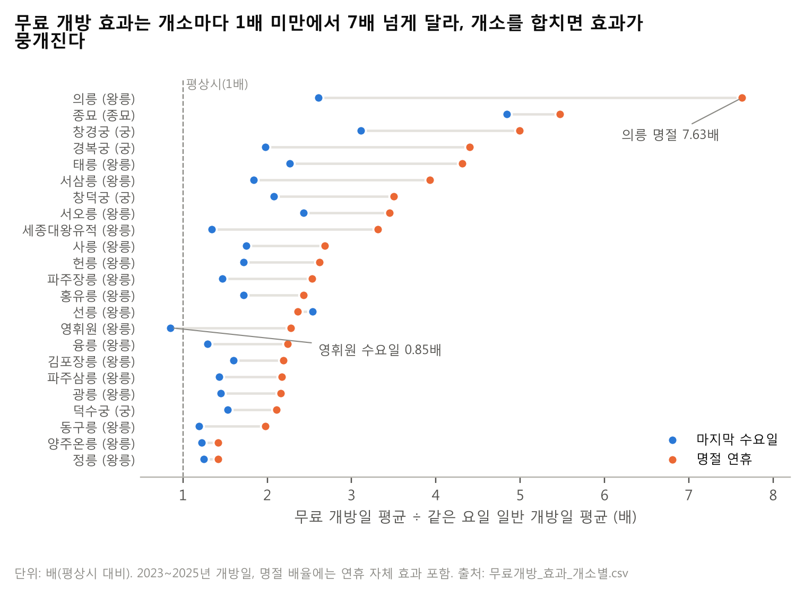

# ⑥ 추가 발견과 다음 할 일

> **질문** 운영팀은 다음에 무엇을 해야 하나?
> **답** 매월 말 재계산, 공지 증원·수요일 하한 적용, 궁·종묘 주 1회 시범, 2026-05-27 수요일 무료 확대 전 달력 변경.

**운영팀은 매월 말에 다음 달 권고표를 다시 계산하고, 공지된 임시 무료 개방과 마지막 수요일부터 보정하며, 궁·종묘에서 주 1회 확정을 시범 운영해야 한다.** 근거는 무료 개방 효과가 개소마다 크게 다르고, 달력에 없는 행사와 2026년의 수요일 무료 확대가 권고를 바꿀 수 있다는 발견이다.

## 6-1. 추가 발견

**발견 1. 같은 무료 개방이라도 개소에 따라 효과가 7배 넘게 차이 난다.** 배율 = 무료 개방일 평균 ÷ 같은 요일 일반 개방일 평균(2023~2025년 개방일)이다. 마지막 수요일 배율은 종묘 4.84, 창경궁 3.11, 경복궁 1.98, 덕수궁 1.53, 왕릉 중앙값 1.54(0.85~2.61)이다. 명절 연휴 배율은 종묘 5.47, 궁 중앙값 3.95, 왕릉 중앙값 2.40이며, 의릉은 7.63으로 가장 크다. 개소를 합쳐 예측하면 이 차이가 평균에 묻혀 배율이 큰 곳에서 인력이 모자랄 수 있어, 예측과 보정 배율을 모두 개소별로 두었다. 명절 배율에는 연휴 자체의 효과가 섞여 있고, 보정 규칙의 배율은 원점 전날까지의 기록으로 따로 계산했다.

**발견 2. 종묘대제는 데이터 달력에 없는 가장 큰 단일 행사이다.** 5월 첫 일요일에 열리며 관람객이 평소의 11.61배였다(가이드 3쪽, 행사는 국가유산청 공지로 확인[^1]). 2025년 부족 2위(5/4 종묘, 19.36명 부족)가 이날이다. 매년 날짜가 정해진 행사라 달력 열 하나로 넣을 수 있다.

**발견 3. 2026년 5월 27일부터 수요일 무료 개방이 매주로 넓어진다(가이드 7쪽).** 조선왕릉부터 시작해 덕수궁·창덕궁·창경궁·종묘에도 차례로 적용된다. 권고 기간(2026년 1월) 밖이라 권고에는 넣지 않았다. 적용 뒤에는 `is_last_wednesday`와 규칙 B를 「해당 개소의 모든 수요일」로 바꿔야 하며, 관람객이 여러 수요일로 나뉠 수 있어 지금의 마지막 수요일 배율을 그대로 쓰면 과배치될 수 있다.

**발견 4. 이웃 궁 휴관과 날씨는 기대보다 효과가 작다.** 이웃 궁이 쉬는 날 창덕궁 화요일 관람객은 1.44배였지만 모형에 넣으면 비용이 153만 원 늘었다(④ FVA 8행). 비 오는 날은 관람객이 줄어(평일 강수량 10mm면 궁 약 −22%, 왕릉 약 −28%) 남는 쪽의 오차라, 날씨를 완벽하게 알아도 줄일 수 있는 비용은 약 0.20억 원 이하였다([완벽한 예보 가정], ④ 4-4). 먼저 모을 정보는 날씨보다 행사 공지이다.

[^1]: 국가유산청 공지 (2025년 종묘대제). https://www.cha.go.kr/multiBbz/selectMultiBbzView.do?id=21002&no=27662&bbzId=newpublic&pageIndex=13&pageUnit=10&strWhere=t&searchWrd=&sdate=&edate=&mn=NS_01_01

## 6-2. 권고를 바꿀 수 있는 변수

| 변수 | 무엇이 바뀌나 | 운영팀 행동 |
|---|---|---|
| 미리 공지되는 임시 무료 개방 | 행사일 관람객이 개소별 배율만큼 늘어남 (2025년 코리아 그랜드 페스티벌) | 공지가 행사 14일 전까지 나오면 그 행사일 인원을 배율만큼 추가 |
| 수요일 무료 개방 확대 (2026-05-27부터) | 무료 수요일이 월 1번 → 4~5번, 수요일 배율이 낮아질 수 있음 | 적용 개소부터 달력 규칙 변경, 몇 주 실적으로 배율 재계산 |
| 종묘 수요 급증 (종묘대제 등) | 종묘는 마지막 수요일 4.84배, 명절 5.47배, 종묘대제 11.61배로 변동이 가장 큼 | 정기 행사를 달력 열로 추가 |
| 임시 휴관 | 예정 휴관이 아닌 날에 문을 닫으면 그날은 관람객 응대 인력이 필요 없어짐 | 그날 해당 개소 인원은 관람객 응대 대신 개소 정비·관리나 직원 교육을 한다 (팀 방침) |

## 6-3. 운영팀이 다음에 할 일

**시점별**

1. **매월 말에 다음 달 권고표를 다시 계산한다.** 원점 = 다음 달 1일, 학습 = 전날까지. 2026년 2월 권고표는 2026-01-31에 계산한다.
2. **임시 무료 개방 공지가 나오면 행사일 인원을 개소별 배율만큼 추가하고, 마지막 수요일에는 하한을 적용한다**(1단계, ④ 4-6 방안 3). 근무자가 일정을 아는 시점은 지금과 같다.
3. **3개월 뒤 궁·종묘 5곳에서 주 1회 확정을 시범 운영하고**, 근무자 부담과 실제 절감을 비교한다(2단계, 방안 7). 결과를 보고 전체 주 1회(3단계, 방안 5)를 정한다.

**개소별**

4. **궁·종묘부터 적용한다.** 비용의 72.6%가 궁, 8.1%가 종묘에서 나오고(⑤ 5-1), 왕릉의 주 1회 효과는 0.25억 원으로 작다.
5. **수요일 무료 개방이 적용되는 개소부터 달력 규칙을 바꾼다.** 왕릉은 2026-05-27부터, 덕수궁·창덕궁·창경궁·종묘는 적용일이 공지되면 바꾸고, 적용 후 4주 정도의 실적으로 수요일 배율을 다시 계산한다.

**정보별**

6. **달력에 종묘대제(5월 첫 일요일) 같은 정기 행사 열을 추가한다.**
7. **더 모을 정보**: 임시 무료 개방 공지 이력(공지일 포함), 궁·종묘의 매주 수요일 무료 개방 적용일, 왕릉 영업일 최소 1명의 실제 필요성(1월 과배치 추정 0.63억 원, ⑤ 5-7), 관람객 집계 방식. 인접 왕릉끼리 인력을 나누는 방안도 검토한다.

---

### 자기 점검표 (⑥)

| 점검 항목 | 결과 |
|---|---|
| 맡은 요구사항 | 가이드 ⑥: 앞 항목에 없는 발견 1개 이상(4개) ✅, 다음 할 일(재계산 시기 ✅, 먼저 적용할 개소 ✅, 더 모을 정보 ✅) / 추가 채점: 팀이 따로 찾은 발견 ✅ |
| 숫자 출처 | 배율: `무료개방_효과_개소별.csv` / 11.61배: 가이드 3쪽(REPORT_SPEC 5-10) / 19.36명: `오차_상위10건.csv` / 2026-05-27: 가이드 7쪽(골격 6-1) / 1.44배·−22%·−28%: 골격 4-4, 6-1 / 1,527,342원: `FVA_앙상블.csv` / 0.20억 원: `날씨_완벽예보_근사.csv` / 72.6%·8.1%: `오차_유형별.csv` / 0.25억 원: `운영방안_비교_구분별.csv` / 0.63억 원: `권고표_2026_01_최종.csv` 재계산 / 도표 10: `figures/fig10_개소별무료개방배율.png` |
| v9 축약 | 첫 문단·발견 1·3·4 문장 축약 (숫자 그대로) |
| 8절 반영 | 10번(종묘대제 출처 주소) ✅ / 11번(억 원) ✅ |
| 1절 결정과 어긋남 | 없음. 수요일 무료 확대는 권고 범위 밖 참고로만 씀 |
| 남은 `[팀원 결과 대기]` | 없음 |
